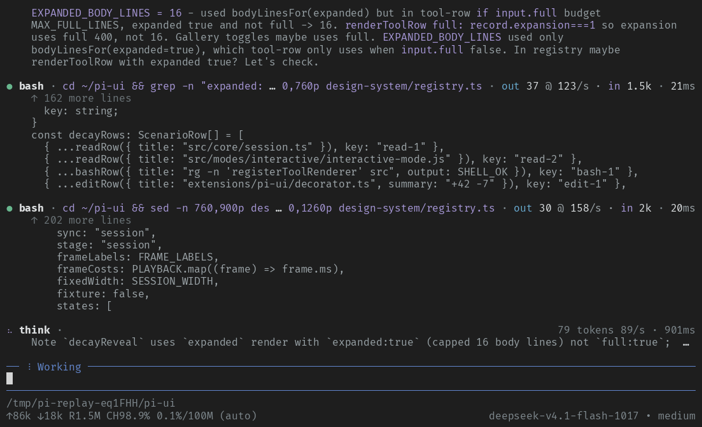
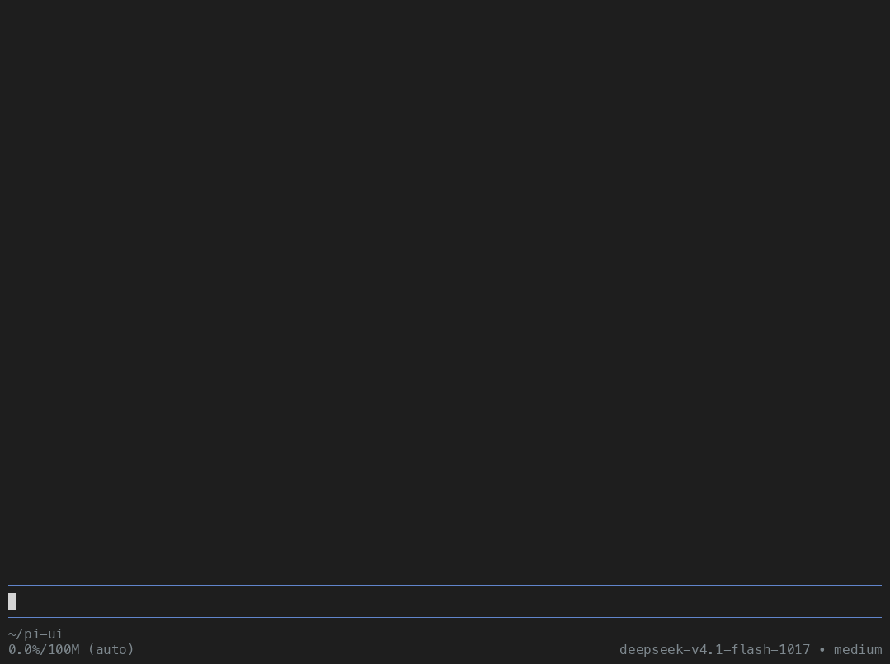
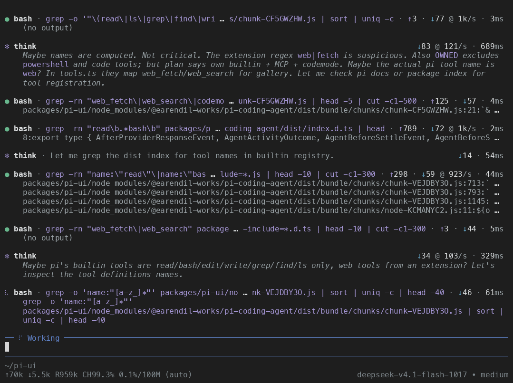

# pi-ui

pi-ui (`@adrienbrault/pi-ui`) is an extension for the [pi coding agent](https://pi.dev) that changes how pi draws tool calls and thinking blocks in the terminal.

## What it changes

- **Older blocks get shorter.** The newest tool call or thought shows up to 8 lines of output. Every two newer blocks, an older block loses one line, down to 3 lines and a `⋮ N more lines` notice. Lines leave one at a time instead of all at once.
- **Old runs fold into one line.** About ten blocks back, or when you send a new prompt, consecutive thoughts and tool calls fold into a summary such as `Thought for 6.3s, read 1 file, ran 1 shell command · 1 failed`. Failed calls fold with the others, and the summary keeps their count.
- **Click to open, hover to see what a click does.** Clicking a block opens its full output (up to 400 lines) and its full command or path. Clicking a summary lists its members in aligned columns, and each member opens on its own. Hovering a block that can open highlights its notices and shows a scroll bar in the left margin.
- **Thinking blocks per message.** Each thought shows its elapsed time, token count and rate, and the end of its text while it streams. pi's own thinking label is global; pi-ui sets it per message.
- **Line numbers and highlighting.** `read` output and `edit` diffs are numbered and syntax-highlighted. Shell commands that print one file (`cat`, `head`, `tail`, `sed -n`, `bat`, `nl`, …) or search results (`rg`, `grep`, `git grep`, `ag`) get line numbers in a gutter, file headers and highlighting.
- **Diffs for files a shell command changed.** In a git work tree, pi-ui records which files a `bash` command created, changed or deleted, and shows their diffs under the command's output. The diffs are saved with the session.
- **Tokens and rates.** Headers show output and input tokens with their rates, for example `out 26 @ 48/s · in 60 @ 2.4k/s`. A status item shows the prefill rate when the provider reports it. pi-ui asks llama.cpp providers for their timings; set `PI_UI_LLAMA_TIMINGS=<provider id>` when your llama.cpp provider has another id.

## Demo

These recordings are a real pi session (deepseek reviewing this repository) replayed in pi with pi-ui, at the session's recorded pace, sped up slightly. They were made with `bun run replay` (see Development).

A long thought as it streams. The newest lines stay at the bottom, the header counts its tokens, rate and time, and the shell commands it decides to run follow.



The start of a session. Tool rows show their output, and older blocks lose lines as newer ones arrive.



Older blocks folded into one summary. Clicking the summary lists its members in columns; clicking a member opens its full command and output.



## Install

```bash
pi install npm:@adrienbrault/pi-ui
# or from GitHub
pi install git:github.com/adrienbrault/pi-ui
```

To try it for one session without installing it:

```bash
pi -e npm:@adrienbrault/pi-ui
# or from a local checkout
pi -e /path/to/pi-ui/packages/pi-ui/extensions/index.ts
```

Add `--no-extensions` to load pi-ui without your other extensions.

Hover and click need pi's fullscreen mode, which is the default. In regular mode (`--tui-mode regular`), the terminal keeps the mouse and its scrollback: blocks still shorten and fold, but there is no hover, click or scroll bar.

## Requirements

- pi 1.5. pi-ui is developed and tested against `@earendil-works/pi-coding-agent` and `@earendil-works/pi-tui` 1.5.2.
- git, for the file diffs under shell commands. Without git, or outside a git work tree, pi-ui skips them.
- Bun, only to work on this repository.

## Compatibility

- **pi internals.** Tool rows use pi's public `registerToolRenderer`. Per-message thinking, folding across rows and the scroll bar also read and wrap internal pi components. pi-ui checks for each method it uses before using it; when one is missing, that part keeps pi's default rendering. A new pi version can still change how these parts look.
- **Tools pi-ui draws.** `read`, `ls`, `grep`, `find`, `ffgrep`, `fffind`, `multi_grep`, `write`, `edit`, `bash`, `powershell`, `web_fetch`, `web_search`, `fetch_content` and every `mcp__*` tool. Other tools keep their own renderers and end a folded run. Another extension that renders the same tools, or changes pi's thinking labels, will conflict with pi-ui; which one wins depends on load order.
- **File diffs.** Before a shell command runs, pi-ui snapshots the work tree. It skips repositories with more than 20,000 files and stops after 1 second. pi runs a message's tool calls in parallel: a file that an `edit` or `write` call changes while a shell command runs is left out of the command's diffs, but two shell commands running at the same time in one work tree can each show the other's changes.

## Development

```bash
bun install
bun run check        # typecheck, lint, format, tests and fixture drift; under a second
bun run ds           # regenerate the golden fixtures in design-system/fixtures/
bun run ds:show read # print the cards whose id contains "read" (--width N, --theme dark|light, --ascii)
bun run e2e          # drive a real pi in tmux through scripted, offline sessions (needs tmux)
bun run replay -- ~/.pi/agent/sessions/<project>/<session>.jsonl --list                         # numbered turns, messages and tool calls
bun run replay -- <session.jsonl> --until message:7@50% --shot thinking.png                      # pause mid-stream, save a PNG
bun run replay -- <session.jsonl> --speed 2 --from message:5@0% --until tool:12:end --gif run.gif # record a GIF between two points
```

The design system renders real pi components and pi-ui's renderers to ANSI fixtures, which are committed. `ds:check`, part of `check`, fails when a renderer change is not reflected in the fixtures. Cards render against the pi version installed in `packages/pi-ui`; set `PI_CODING_AGENT_ROOT` to render against another pi install.

`bun run replay` plays a recorded pi session again in a real pi with pi-ui, offline, in its own tmux pane: the recorded messages stream at about their recorded pace, tools return their recorded results after their recorded time, and nothing runs or touches files. It pauses at a stop point (`turn:N`, `message:N[@P%]`, `tool:N|ID[:start|:end]` or `end`, each reached once it has happened: `turn:2` when pi settles after turn 2), can hover or click a row by its text, and saves the screen as a PNG, ANSI text or a GIF (needs tmux, `agg` and `ffmpeg`). `bun run replay -- --help` lists the options; `bun run replay:smoke` checks the loop on a synthetic session.

[AGENTS.md](https://github.com/adrienbrault/pi-ui/blob/main/AGENTS.md) describes the workflow and the rules the code must keep. [DESIGN.md](https://github.com/adrienbrault/pi-ui/blob/main/DESIGN.md) is the component contract, and [docs/PLAN.md](https://github.com/adrienbrault/pi-ui/blob/main/docs/PLAN.md) records the decisions and the roadmap.

## Repository layout

```
packages/pi-ui/render/      pure renderers: tool rows, thinking blocks, group summaries, shell output
packages/pi-ui/extensions/  the pi extension: folding, fades, hover, scroll bar, throughput, file diffs
design-system/              card registry, fixture builder, terminal card viewer, golden fixtures
dev/                        tmux end-to-end harness and its offline provider
dev/replay/                 replay of recorded sessions in pi, with PNG and GIF capture
```

## License

MIT. See [LICENSE](https://github.com/adrienbrault/pi-ui/blob/main/LICENSE).
